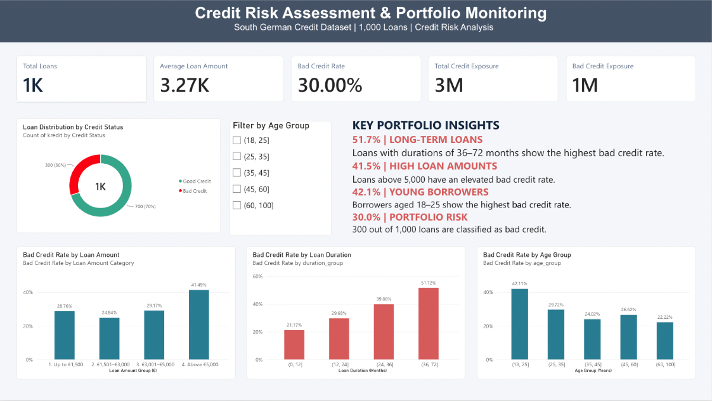

# Credit Risk Assessment & Portfolio Monitoring

## Project Overview

This project analyzes consumer credit data to identify credit risk patterns, evaluate portfolio exposure, and develop data-driven recommendations for risk monitoring.

The analysis uses Python to explore how loan characteristics and credit history relate to credit outcomes, with a particular focus on risk segmentation and portfolio-level exposure.

## Dataset

**Source:** UCI South German Credit Dataset

- 1,000 credit records
- 20 explanatory variables
- Target variable: `kredit`
  - `0` = Bad Credit
  - `1` = Good Credit

The dataset is a historical benchmark and does not represent a current banking portfolio.

## Tools & Technologies

- Python
- Pandas
- Matplotlib
- Seaborn
- Jupyter Notebook
- Power BI
- DAX
- Power Query

## Key Portfolio KPIs

| KPI | Value |
|---|---:|
| Total Loans | 1,000 |
| Bad Credit Rate | 30.0% |
| Total Credit Exposure | 3,271,248 |
| Bad Credit Exposure | 1,181,438 |
| Bad Credit Exposure Share | 36.1% |
| Average Loan Amount — Bad Credit | 3,938.13 |
| Average Loan Amount — Good Credit | 2,985.44 |

*Credit exposure represents the sum of loan amounts in the dataset, not outstanding balances or realized losses.*

## Power BI Dashboard

An interactive Power BI dashboard was developed to analyze credit risk patterns and monitor portfolio performance using the South German Credit dataset.

The dashboard includes:
- **Portfolio KPIs:** Total loans, average loan amount, bad credit rate, total credit exposure, and bad credit exposure.
- **Credit Risk by Loan Duration:** Comparison of bad credit rates across different loan terms.
- **Credit Risk by Loan Amount:** Analysis of credit risk across loan amount categories.
- **Credit Risk by Age Group:** Identification of higher-risk borrower age groups.
- **Interactive Filtering:** Age-based portfolio segmentation.
- **Key Portfolio Insights:** Summary of the main findings from the full dataset.

### Dashboard Preview

## Key Findings

### 1. Loan Duration and Credit Risk

The Bad Credit rate increases from 21.2% for loans with maturities of up to 12 months to 51.7% for loans exceeding 36 months.

Loans with maturities above 24 months account for 43.4% of total credit exposure but represent 55.4% of Bad Credit exposure.

### 2. Credit Exposure Concentration

Although 30% of loans are classified as Bad Credit, they represent 36.1% of total credit exposure.

The average loan amount in the Bad Credit group is approximately 31.9% higher than in the Good Credit group.

### 3. Credit History Segmentation

Bad Credit rates vary substantially across credit history categories, ranging from 17.1% to 62.5%.

Credit history category 2 contains 56.3% of all Bad Credit loans, demonstrating the importance of distinguishing between segment-level risk rates and portfolio-level risk concentration.

### 4. Borrower Age

Borrowers aged 19–25 have the highest observed Bad Credit rate at 42.1%, compared with the portfolio average of 30%.

This finding is descriptive and should not be interpreted as a causal relationship or used independently for credit decisions.

### 5. Loan Purpose

Bad Credit rates differ across loan purpose categories.

Category 6 has the highest observed Bad Credit rate (44.0%), while category 0 contributes more Bad Credit loans because of its larger customer base.

Small sample sizes in certain categories limit the reliability of direct comparisons.

## Business Recommendations

1. **Prioritize long-term loan monitoring:** Regularly review risk indicators for loan segments with maturities exceeding 36 months.

2. **Monitor exposure concentration:** Track both loan-count-based Bad Credit rates and exposure-based risk indicators.

3. **Improve risk segmentation:** Combine credit history, loan amount, and loan duration to identify segments requiring further investigation.

4. **Maintain and enhance portfolio monitoring:** Use the Power BI dashboard to track key risk indicators, monitor exposure concentrations, and investigate risk patterns across loan segments.

5. **Validate findings before implementation:** Assess results using more recent and representative data, including appropriate fairness and regulatory considerations.

## Methodology

1. Data Quality Assessment
2. Exploratory Data Analysis
3. Credit Risk Segmentation
4. Portfolio Exposure Analysis
5. Business Insights & Recommendations

## Limitations

- The dataset is historical and may not reflect current lending conditions.
- The analysis identifies associations, not causal relationships.
- Credit outcomes are provided as binary classifications rather than observed default dates or realized losses.
- The analysis does not estimate probability of default or expected credit loss.
- Results should not be used directly for automated lending decisions.

## Future Improvements

- Compare Logistic Regression, Random Forest, and Gradient Boosting approaches.
- Evaluate model performance using ROC-AUC, precision, recall, and confusion matrices.
- Explore model interpretability and fairness.
- Develop an interactive portfolio monitoring dashboard.

## Data Source

UCI Machine Learning Repository — South German Credit Dataset.
